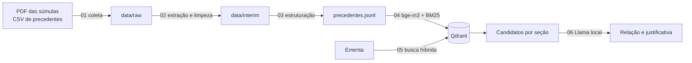

# RAG STJ: consonância e afins

Recebe uma ementa e mostra as súmulas e os precedentes qualificados do Superior Tribunal de Justiça relacionados a ela.
Depois, um Llama local compara cada candidato com a ementa, diz se ela está em consonância, diverge ou não trata da
mesma regra, e justifica a resposta. Tudo roda na própria máquina, com [Qdrant](https://qdrant.tech) e
[Ollama](https://ollama.com).

## Exemplo

Para a ementa abaixo, sobre prisão preventiva decretada de ofício:

> Verifique se exista alguma sumula em consonancia com a ementa abaixo: PRISÃO PREVENTIVA. PORTE ILEGAL DE ARMA DE FOGO
> DE USO PERMITIDO, TRÁFICO DE DROGAS E ASSOCIAÇÃO PARA O TRÁFICO. […] não é possível a decretação da prisão preventiva
> de ofício em face do que dispõe a Lei n. 13.964/2019 […]

a busca devolve a Súmula 676 em primeiro lugar, com aderência forte, e o `llama3.1:8b` responde:

| Súmula | Relação | Justificativa |
|---|---|---|
| 676/STJ | CONSONANTE, jurídica | "A ementa trata da impossibilidade de decretação de prisão preventiva de ofício, o que é confirmado pelo precedente que também menciona a Lei n. 13.964/2019 como base para essa regra." |
| 409/STJ | SEM CONSONÂNCIA, fática (tipo errado) | "A ementa trata de prisão preventiva e conversão de prisão em flagrante, enquanto o precedente trata de prescrição em execução fiscal." |
| 668/STJ | SEM CONSONÂNCIA, jurídica | "A ementa não trata da regra do precedente, pois trata de prisão preventiva e porte ilegal de arma de fogo de uso permitido, enquanto o precedente trata especificamente da hediondez do delito…" |

Mais exemplos, inclusive uma ementa que contraria a súmula e uma justificativa fática, estão em
[docs/resultados.md](docs/resultados.md).

## Como funciona



1. **Base:** 676 súmulas, do PDF oficial, e 2.369 precedentes qualificados (temas repetitivos, controvérsias, IAC, PUIL
   e SIRDR), do portal de Dados Abertos do STJ.
2. **Busca híbrida:** cada registro tem um vetor denso (`bge-m3`) e um esparso (BM25 em português), combinados por RRF.
   A busca roda separadamente para súmulas, precedentes com tese, precedentes em andamento e inativos.
3. **Justificativa:** cada candidato vai para o modelo com a ementa. A resposta é um JSON com a relação, o trecho da
   ementa, o tipo da justificativa (jurídica ou fática) e o texto. O código confere se o trecho existe e se há números
   inventados.

Os detalhes estão em [docs/arquitetura.md](docs/arquitetura.md).

## Estrutura

```
rag-stj/
├── data/                 dados baixados e gerados, fora do Git (ver data/README.md)
│   ├── raw/
│   ├── interim/
│   └── processed/
├── docs/
│   ├── arquitetura.md    extração, indexação, busca e prompt
│   └── resultados.md     exemplos de saída
├── notebooks/            pipeline em 7 etapas (ver notebooks/README.md)
│   ├── 01_coleta_fontes.ipynb
│   ├── 02_extracao_limpeza.ipynb
│   ├── 03_estruturacao_registros.ipynb
│   ├── 04_indexacao_qdrant.ipynb
│   ├── 05_busca_consonancia.ipynb
│   ├── 06_justificativa_llama.ipynb
│   └── 07_avaliacao.ipynb
├── docker-compose.yml    Qdrant
├── pyproject.toml        dependências (uv)
└── uv.lock
```

## Como rodar

Requer [Docker](https://www.docker.com), [Ollama](https://ollama.com) e [uv](https://docs.astral.sh/uv/). Os modelos
ocupam cerca de 10 GB.

```bash
git clone <url-do-repositorio> rag-stj
cd rag-stj
uv sync
docker compose up -d
ollama pull bge-m3
ollama pull llama2:7b
ollama pull llama3.1:8b   # usado na comparação dos notebooks 06 e 07
uv run jupyter lab notebooks
```

Execute os notebooks em ordem, de 01 a 06. O 07 é opcional e leva cerca de 15 minutos. Depois da primeira execução,
basta usar o 05 ou o 06 para consultar outras ementas:

```python
analisar("Verifique se existe súmula em consonância com a ementa abaixo: ...")
```

O padrão é o `llama2:7b`. Nos testes, o `llama3.1:8b` acertou bem mais (veja abaixo). Para usá-lo, mude `MODELO_LLM` no
início do notebook 06.

## Resultados

| Teste | `llama2:7b` | `llama3.1:8b` |
|---|---|---|
| Relação correta (11 casos) | 3, sempre CONSONANTE | 10 |
| Tipo da justificativa correto (8 casos) | 5, sempre jurídica | 5 |

Na busca, a súmula esperada ficou em primeiro lugar em 9 de 12 paráfrases e entre as três primeiras em 11 de 12. Os
casos foram escritos à mão e o prompt foi ajustado olhando para eles, então os placares são otimistas.

## Limitações

- **A base de súmulas é o PDF oficial de 05/12/2025**, que vai até a Súmula 676. Súmulas posteriores não aparecem:
  atualize com `ATUALIZAR = True` no notebook 01 e confira a data impressa.
- **A aderência não indica concordância.** Ela mede proximidade de texto, e uma ementa contrária também fica próxima
  da súmula. Os limiares vieram de poucos exemplos.
- **A avaliação do modelo é só um apoio.** Os dois modelos erram, e uma justificativa bem escrita não garante que a
  classificação esteja certa. O `llama2:7b` chega a inventar conteúdo de lei.
- **O rótulo jurídica ou fática é pouco confiável**, principalmente nos casos fáticos, que muitas vezes vêm marcados
  como jurídicos. Leia o texto da justificativa em vez de confiar só no rótulo.
- **A verificação automática é limitada.** Ela confere o trecho citado e os números, mas não o raciocínio, e números
  escritos por extenso podem gerar alerta falso.
- **A limpeza não corrige falhas de digitação da fonte.** Alguns textos de precedentes têm palavras coladas ou
  pontuação sem espaço, como "mediantefundamentação" no Tema 1347.
- **Não há validação com ementas reais anotadas por especialistas.** Os testes usam ementas escritas à mão.

## Fontes e licença dos dados

- Súmulas: [Enunciados das Súmulas do STJ](https://scon.stj.jus.br/docs_internet/jurisprudencia/tematica/download/SU/Verbetes/VerbetesSTJ.pdf).
- Precedentes qualificados: [Superior Tribunal de Justiça, Dados Abertos](https://dadosabertos.web.stj.jus.br/dataset/precedentes-qualificados),
  licença CC-BY.

Os dados não são versionados no repositório. O notebook 01 baixa as fontes diretamente do STJ.
