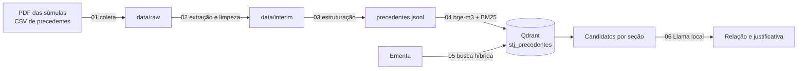

# Arquitetura

Tudo roda localmente. O Qdrant fica em um contêiner Docker, e os modelos de embedding e de linguagem rodam no Ollama.
Nenhum texto é enviado para serviços externos depois do download das fontes.

## Extração e limpeza

As súmulas vêm de um PDF. O texto é extraído com `pypdf` e dividido pelos cabeçalhos `SÚMULA n … VEJA MAIS`. Em cada
súmula, a limpeza:

- remove o rodapé das páginas, com o endereço do SCON e a numeração;
- junta espaços e quebras de linha;
- junta palavras com hífen quebradas pela extração, como "estado- membro". Antes de sigla, como "Doação- ITCD", o hífen
  pode ser separador e fica como está;
- separa o enunciado em vigor da citação e do histórico. A redação anterior fica em `historico` e não entra no índice.

Os precedentes vêm de um CSV, que já está em colunas. A limpeza junta espaços, remove duplicados e descarta linhas sem
tese e sem questão.

No fim, uma auditoria procura HTML, caracteres de controle, encoding corrompido, restos de rodapé e hífens quebrados, e
interrompe o notebook se encontrar algum. Acentos, stopwords e maiúsculas não são alterados, para o texto exibido
continuar fiel à fonte.

## Indexação

Cada registro de `precedentes.jsonl` vira um ponto, sem divisão em trechos, porque enunciados e teses são curtos. O
ponto tem dois vetores:

| Vetor | Modelo | Para quê |
|---|---|---|
| `denso` | `bge-m3` via Ollama, 1024 dimensões, cosseno | Aproximar textos de mesmo sentido escritos com palavras diferentes |
| `bm25` | `Qdrant/bm25` do `fastembed`, em português, com IDF | Achar termos exatos, como "de ofício" ou "Lei 13.964" |

Em precedentes com tese, o texto indexado é a questão seguida da tese, porque a questão descreve o problema jurídico.
Os campos `fonte`, `vigente` e `tem_tese` têm índice de payload para os filtros da busca.

## Busca

A consulta passa por `limpar_query`, que tira o pedido do início ("Verifique se existe súmula … abaixo:") e deixa só a
ementa. Depois, a busca roda uma vez para cada seção:

| Seção | Filtro | Quantidade |
|---|---|---|
| Súmulas | `fonte=sumula`, `vigente=true` | 5 |
| Precedentes com tese | `fonte=precedente`, `vigente=true`, `tem_tese=true` | 5 |
| Em andamento | `fonte=precedente`, `vigente=true`, `tem_tese=false` | 3 |
| Inativos | `vigente=false`, só com aderência forte | até 5 |

Em cada seção, o Qdrant busca 50 candidatos pelo vetor denso e 50 pelo BM25 e combina as duas listas por RRF. Buscar
por seção evita que os mais de mil temas tirem as súmulas do resultado.

A aderência exibida é o cosseno entre a ementa e o candidato no vetor denso. Candidatos abaixo de 0,50 são descartados,
e a partir de 0,65 a aderência é chamada de forte. Esses limiares vieram de poucos exemplos e servem só como
orientação: uma ementa que contraria a súmula também tem aderência alta.

## Justificativa

Os três primeiros candidatos de súmulas e os dois primeiros de precedentes com tese vão, um de cada vez, para o modelo
local. O modelo recebe só a ementa e o enunciado, com `temperature=0` e `seed=42`, e responde em JSON validado por um
esquema:

| Campo | Valores |
|---|---|
| `regra_do_precedente` | A regra do precedente em uma frase |
| `trecho_da_ementa` | Trecho copiado da ementa, vazio se nenhum tratar da regra |
| `tipo_justificativa` | `JURIDICA` ou `FATICA` |
| `justificativa` | Obrigatória, com pelo menos 20 caracteres |
| `relacao` | `APLICA`, `CONTRARIA` ou `NAO_TRATA`, exibidas como CONSONANTE, DIVERGENTE e SEM CONSONÂNCIA |

A pergunta parte do precedente ("a ementa aplica, contraria ou não trata desta regra?"), porque perguntar se "a questão
é a mesma" fazia o modelo errar em ementas com vários assuntos.

Depois da resposta, o código gera alertas quando:

- a justificativa vem vazia;
- a relação é CONSONANTE ou DIVERGENTE e o trecho citado não existe na ementa, ou não há trecho;
- a resposta usa um número de dois ou mais dígitos que não aparece na ementa nem no precedente.

Essas verificações pegam invenções simples, mas não conferem o raciocínio. Uma justificativa errada sem número novo
passa sem alerta.
